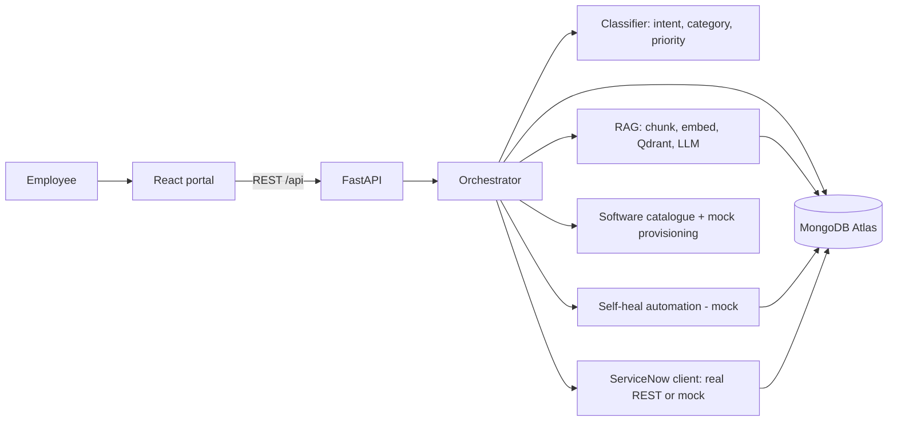

# AI-Powered ITSM & Intelligent Helpdesk Automation Platform

A working prototype for the Sorim.AI technical assessment. An employee describes a problem or request in plain
English; the platform understands it, searches approved IT knowledge, decides what to do, can fix safe issues
automatically, records everything in ServiceNow, and hands over to a human when the AI is not sure.

| Layer | Technology |
|---|---|
| Frontend | React 18 (JavaScript) + Vite |
| Backend | Python 3.10+ / FastAPI |
| Database | MongoDB Atlas (cloud). Falls back to an in-memory DB if no URI is set |
| LLM | Hugging Face `Qwen/Qwen2.5-0.5B-Instruct` (open source, Apache-2.0) |
| Embeddings | `sentence-transformers/all-MiniLM-L6-v2` |
| Vector DB | Qdrant (open source, Apache-2.0, free; local mode needs no server or account; cosine similarity) |
| ITSM | ServiceNow Table REST API, with a built-in mock when no instance is available |

## 1. Architecture



Request journey (`backend/app/orchestrator.py`):
**Employee request → AI understanding → knowledge retrieval → decision → automation → ServiceNow → resolution.**

1. `classifier.py` extracts intent, category/sub-category, impact, urgency, priority, assignment group, summary.
2. `knowledge.py` retrieves the best knowledge chunks from Qdrant.
3. A confidence score is computed: `0.4 × intent + 0.3 × category + 0.3 × retrieval`.
4. The request is routed to one of four workflows: knowledge question, incident, automatable issue, service request.
5. Every step is stored as a trace (shown in the **AI Analysis** screen) and every automated action is written to `audit_logs`.

## 2. Setup (run locally)

Full beginner instructions are in `GUIDE.md`. Short version:

```bash
# Backend  (terminal 1)
cd backend
python -m venv .venv
.venv\Scripts\activate            # Windows   |  source .venv/bin/activate   (Mac/Linux)
pip install -r requirements.txt
copy .env.example .env            # Windows   |  cp .env.example .env
uvicorn app.main:app --reload --port 8000     # API docs: http://localhost:8000/docs

# Frontend (terminal 2)
cd frontend
npm install
npm run dev                       # http://localhost:5173
```

Tests (work offline): `cd backend && pytest -v`

### Configuration (`backend/.env`, never committed)
| Variable | Purpose |
|---|---|
| `MONGODB_URI` | MongoDB Atlas connection string. Empty = in-memory database |
| `SERVICENOW_INSTANCE`, `SERVICENOW_USER`, `SERVICENOW_PASSWORD` | ServiceNow developer instance. Empty = mock |
| `EMBEDDING_BACKEND`, `EMBEDDING_MODEL` | `auto` / `st` / `hash`, and the sentence-transformers model |
| `LLM_BACKEND`, `LLM_MODEL` | `auto` / `hf` / `extractive`, and the Hugging Face model |
| `QDRANT_PATH`, `QDRANT_URL`, `QDRANT_API_KEY` | Qdrant storage folder (default local mode), or a Qdrant server / cloud cluster |
| `CONFIDENCE_THRESHOLD` | Below this the request is escalated to a human (default 0.45) |

## 3. Model choice
* **LLM: Qwen2.5-0.5B-Instruct.** Free, Apache-2.0, about 1 GB, runs on a normal laptop CPU, and follows the
  instruction "answer only from the context". A bigger model such as `Qwen2.5-1.5B-Instruct` can be selected with `LLM_MODEL`.
* **Embeddings: all-MiniLM-L6-v2.** 384 dimensions, about 90 MB, fast, a standard choice for semantic search.
* If a model cannot be downloaded the app degrades safely (hashing embeddings / extractive answers) and shows
  the active models in the sidebar and in the AI Analysis screen.

## 4. RAG approach
`Document → Chunking → Embedding → Vector DB → Semantic search → LLM → Grounded response`
* 9 sample articles in `backend/knowledge_base/` (VPN, Password Reset, Account Unlock, Outlook, Wi-Fi, Laptop
  Performance, Software Installation, Application Access, Application Restart and Cache Clearing).
* Chunking: split by `##` heading, then pack lines up to about 90 words with a one-line overlap (`knowledge.py`).
* Vector DB: **Qdrant** in *local mode* (stored in `backend/vector_store/qdrant`, no server, no account, free forever). Each point holds the vector **and** its metadata (article id, title, category, section, text), so results come back with their sources and can be filtered by category. To use a Qdrant server or a free Qdrant Cloud cluster, set `QDRANT_URL` / `QDRANT_API_KEY`; no code change.
* Retrieval: top-3 chunks by cosine similarity. Chunk and article metadata are also stored in MongoDB.
* Generation: the LLM receives only the retrieved chunks and the instruction to answer `INSUFFICIENT_INFORMATION`
  when the context does not contain the answer.
* Sources (article id, title, section, similarity) are returned with every answer and displayed in the UI.

## 5. AI safety and governance
| Rule | Implementation |
|---|---|
| No hallucination | If the best similarity is below the minimum, or the LLM answers `INSUFFICIENT_INFORMATION`, the bot says the information is unavailable |
| Source attribution | `sources` returned by every RAG answer and shown in the UI |
| Confidence | Score shown with a bar and the threshold marked |
| Human escalation | Confidence below `CONFIDENCE_THRESHOLD` routes incidents to "Service Desk (Human Triage)" and offers a ticket for unanswered questions |
| Safe automation | An action runs only if it is whitelisted **and** an approved KB article supports it; it is validated afterwards and always audit-logged |

## 6. ServiceNow integration
`backend/app/servicenow.py` exposes one client with `create_incident`, `get_incident`, `update_incident`,
`create_service_request`, `update_service_request`.

* **Real mode** (credentials in `.env`): `POST/GET/PATCH https://<instance>.service-now.com/api/now/table/incident`
  and `/api/now/table/sc_request` with basic auth. The assignment group name is looked up in `sys_user_group` to get its `sys_id`.
* **Mock mode** (default): the same payloads are stored in MongoDB and also exposed as REST under
  `/mock-servicenow/api/now/table/...`, with realistic numbers (`INC0010001`, `REQ001245`).

| AI output | ServiceNow field |
|---|---|
| Summary | `short_description` |
| Original text + AI analysis (intent, confidence, sources) | `description` |
| Category / sub-category | `category` (network, software, hardware, inquiry) / `subcategory` |
| Impact / urgency (Individual=3, High=1) | `impact` / `urgency` |
| Priority (P2) | `priority` |
| Assignment group | `assignment_group` (sys_id looked up by name) |
| Self-heal result | `state=6`, `close_code`, `close_notes`, `work_notes` |

Production notes: use OAuth instead of basic auth, a service account with least privilege, the Service Catalog API
(`/api/sn_sc/servicecatalog`) for catalogue items, retries and a queue for failed calls, and map `caller_id` to the real employee.

## 7. API summary (interactive docs at `/docs`)
| Method and path | Purpose |
|---|---|
| `POST /api/chat` | Main entry: classify, retrieve, route, act |
| `GET /api/analyses`, `GET /api/analyses/{id}` | AI Analysis screen data |
| `POST /api/tickets` | "Create ticket" / human escalation |
| `GET /api/tickets`, `GET /api/tickets/{id}` | Local tickets |
| `GET /api/tickets/{id}/servicenow` | Get Incident from ServiceNow |
| `PATCH /api/tickets/{id}` | Update Incident in ServiceNow (in progress / resolved) |
| `GET /api/dashboard` | Totals, AI-resolved, escalated, software requests, automation status |
| `GET /api/software/catalog`, `GET /api/software/requests` | Catalogue and requests (status advances Provisioning → Completed) |
| `GET /api/audit-logs` | Audit trail |
| `GET /api/kb/articles`, `GET /api/kb/articles/{id}` | Knowledge articles |
| `POST /api/kb/search` | Full RAG search with sources (optional `category` filter) |
| `POST /api/kb/reindex` | Rebuild chunks, embeddings and the Qdrant collection |
| `GET /api/health`, `GET /api/config`, `GET /api/users` | Status and configuration |
| `POST /api/admin/reset-mock-directory` | Reset the fake user directory |
| `/mock-servicenow/...`, `/mock-provisioning/...` | Mock ServiceNow and provisioning APIs |

## 8. MongoDB collections
`users`, `tickets`, `chat_history` (every analysis), `service_requests`, `software_catalog`, `automation_actions`,
`audit_logs`, `knowledge_docs`, `knowledge_chunks`, `provisioning_jobs`, `counters`, `mock_sn_incidents`, `mock_sn_requests`.

## 9. Test scenarios (`backend/tests/test_scenarios.py`)
| # | Input | Expected |
|---|---|---|
| 1 | "I cannot connect to VPN since this morning. Authentication keeps failing." | Incident, Network/VPN, P2, Individual/High, Network Support, "VPN authentication failure", INC created, VPN article as source |
| 2 | "My password has expired." | Identify → Diagnose → KB search → Determine → Execute → Validate → ServiceNow incident updated to Resolved; audit log entries |
| 3 | "How do I troubleshoot Outlook synchronization?" | Grounded answer, Outlook article as source, confidence above threshold |
| 4 | "I need Visual Studio Code." | Request `REQ…`, status Provisioning, "ServiceNow Request created successfully" |
| 5 | "What is the capital of France?" | No answer invented, no sources, ticket option; creating the ticket makes an escalated incident |
| 6 | "My account is locked" (Bob) | Account unlocked automatically |
| 7 | "I need Photoshop installed" | Not in catalogue, ticket option |
| 8 | Resolve a ticket, open dashboard | ServiceNow state Resolved, counters update |

Run with `cd backend && pytest -v`. The tests use the offline fallbacks (hashing embeddings, extractive answers, in-memory DB, mock ServiceNow) so they run anywhere.

## 10. Known limitations
* Prototype, not production: no login (the user is chosen from a drop-down), no rate limiting, basic auth to ServiceNow.
* The 0.5B LLM is small; answers are short and it can occasionally refuse when the answer is present. Use a larger model for better quality.
* Intent and category use rules plus embeddings (explainable and fast) rather than a fine-tuned classifier.
* Confidence is a heuristic blend, not a calibrated probability. Thresholds were tuned on a small KB and should be re-tuned for a larger one.
* Automation actions are mocks; nothing real is reset or installed.
* ServiceNow: default sub-category choice lists may not contain "VPN", and a business rule may recalculate priority; check your instance.
* Conversation context is not remembered between messages; each message is analysed independently.

## 11. Project structure
```
backend/app/         main.py, orchestrator.py, classifier.py, knowledge.py, llm.py, embeddings.py,
                     servicenow.py, software.py, automation.py, db.py, config.py, context.py
backend/knowledge_base/   9 markdown articles
backend/tests/       test_scenarios.py, conftest.py
frontend/src/        App.jsx, api.js, pages/{SelfService,Dashboard,AIAnalysis,KnowledgeBase}.jsx, components/ui.jsx
GUIDE.md             step-by-step beginner guide + submission instructions
```
